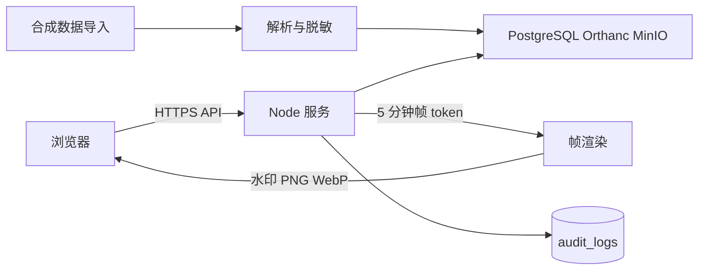

# WP-S0 最小安全边界

状态：2026-09-20 由项目临时负责人批准，限合成数据阶段。本文只整理源开发手册已有安全红线，不新增安全平台或产品功能。

## 数据流

浏览器不可信，只能接收脱敏业务数据和当前渲染帧。PostgreSQL、Orthanc、MinIO、Redis 和 Elasticsearch 只允许内网访问；nginx 是唯一外部入口。

## 必须防止的行为

| 风险 | 源手册最小控制 |
| --- | --- |
| 越权访问 | 登录状态、账号状态、角色/资格、任务分派和资源逐级校验 |
| 原始影像泄露 | 无下载接口；只返回当前带水印渲染帧；数据服务不对外暴露 |
| 批量扒图 | 5 分钟强绑定帧 token、Redis 限流、429、异常锁定和管理员解锁 |
| 脱敏遗漏 | 指定 DICOM 标签处理、首帧 OCR、报告人名遮蔽和人工确认 |
| 操作无法追踪 | 帧访问、标注、审核、发布、导出和权限变更写入只增审计 |
| 单人导出 | 申请人与审批人为不同管理员，链接带失效时间 |

## 五道防线

无下载通道、帧级流式传输、10%～15% 动态水印、按模态限流与锁定、全量审计及保密制度，均按源手册 §2.6 和 §8.4 验收。除这些要求外，不在当前阶段建设额外威胁管理系统。
