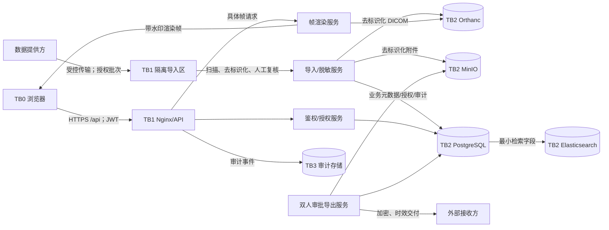

# WP-S0 数据流、信任边界与威胁模型

状态：安全评审草案。仅描述目标架构和必须实现的控制，不代表 SG-1 已批准或控制已验证。

依据：源开发手册 §2.6、§3、§5.1、§7、§8.4；[需求基线](../医学影像标注平台-需求拆解与实施基线.md) §8、WP-S0、SG-1。

## 1. 数据流与信任边界

- TB0 不可信客户端：浏览器及其扩展、缓存、截图和本地网络均不可被信任；不接收原始 DICOM、映射或存储地址。
- TB1 应用边界：TLS 终止、API、隔离导入、脱敏与帧渲染；服务身份按用途分离，禁止把上传区直接暴露给 Web。
- TB2 数据服务边界：PostgreSQL、Orthanc、MinIO、Redis、Elasticsearch 无公网入口，只接受所需服务网段和最小账号。
- TB3 审计边界：业务管理员不得修改/删除审计；可信时间、完整性和归档机制仍待 D-36 批准。
- 外部数据提供方和导出接收方是独立信任域；每次流入/流出均须来源授权、完整性、最小化和交付证据。

## 2. 资产与安全目标

最高价值资产包括原始/去标识化影像、报告附件、`mask_map`/UID 对照、来源授权、账号/资格/任务分派、签名密钥、帧访问和敏感操作审计。目标是保密性、完整性、可用性、用途限制与可追溯性；“去标识化”不等同匿名化。

## 3. 主要威胁与缓解

| 威胁/滥用途径 | 边界 | 必须控制 | 验证时点 |
| --- | --- | --- | --- |
| IDOR、角色/资格/分派绕过 | TB0→TB1 | 集中策略；固定校验顺序；逐资源查询；外部不泄露存在性 | WP-02/SG-2 负向测试 |
| 会话盗用、重放、账号停用后继续访问 | TB0→TB1 | 内存 token、`jti/token_version`、状态每请求生效、强制下线、管理员 2FA | WP-02/SG-2 |
| 批量扒图、修改帧参数、拼接整例 | TB0→帧服务 | 5 分钟且强绑定的帧 token、水印、模态限流、429、锁定/人工解锁、全帧审计 | WP-07/SG-4 抓包和滥用测试 |
| 直接取得原始 DICOM/对象键 | TB0→TB1/TB2 | 无下载路由；只返回平台渲染帧；数据服务不公网暴露；最小网络策略 | SG-4/SG-6 |
| 越权或自批导出 | TB0→导出服务 | 来源/用途校验、申请审批分离、2FA、最小化、加密、时效限次、完整审计 | WP-14/SG-5 |
| zip bomb、路径穿越、符号链接、恶意附件 | 外部→隔离区 | 大小/展开比/文件数/深度限制，规范化路径，类型探测，恶意文件扫描，隔离转换 | WP-04/SG-3 |
| DICOM 标签、私有标签、烧录文字泄密 | 隔离区→TB2 | PS3.15 profile/options、私有标签默认删除、Clean Pixel/Graphics/Descriptors、OCR 与人工复核 | WP-04/SG-3 |
| 日志、错误、ES、缓存泄密 | TB1/TB2/TB3 | 字段最小化、脱敏、禁止 token/密钥/映射/原始文本，TTL 与删除同步 | 各 WP；SG-6 |
| 密钥泄露或用途混用 | TB1/TB2 | 外置、分环境/用途、最小读取、轮换/吊销；JWT/帧/映射/备份密钥分离 | SG-1 方案评审；SG-6 实证 |
| 内部人员滥用或审计被改写 | TB2/TB3 | 职责分离、近期认证、理由、双人审批、只增审计、独立完整性控制和告警 | SG-5/SG-6/SG-7 |
| 删除不完整、备份或导出残留 | TB2/外部 | 数据清单、删除编排、ES/缓存/备份/导出同步处置、删除证据 | D-30 批准后；SG-6 |
| SSRF/注入/XSS/CSRF/错误跨域 | TB0→TB1 | 输入/schema 校验、参数化查询、输出编码、CSP、出站白名单、明确 CORS；Cookie 认证时启用 CSRF | 各模块自动测试及 SG-7 DAST |

## 4. 五道防线映射

1. 无下载通道：任何普通角色及管理员页面都不提供原始影像下载；导出与普通访问完全分离。
2. 帧级流式传输：短时强绑定 token，只返回当前带水印渲染帧，目标缓存后响应不超过 200 ms。
3. 动态水印：账号、姓名和时间以 10%～15% 透明度平铺；附件预览同样适用。
4. 限流与告警：按模态设阈值，异常返回 429 并锁定，只有管理员复核后解锁。
5. 审计与制度：帧访问及敏感操作全留痕，审计只增不删且至少保留 3 年，并配套保密/禁止留存要求。

## 5. 当前残余风险

D-30～D-37 尚未全部取得责任单位或专项安全批准；尤其是精确保留期、等保适用性、生产密钥保管方、事件联系人、审计防篡改方案和 DICOM profile/options。SG-1 在这些内容完成评审前保持“未放行”，系统不得创建真实数据连接或生产秘密。
