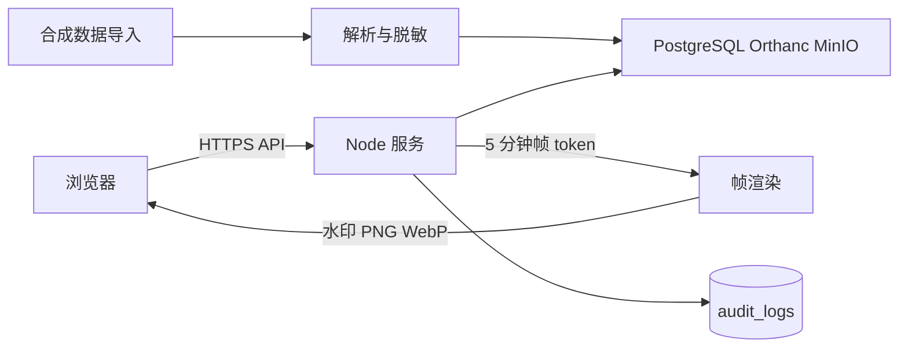

# WP-S0 最小安全边界

状态：2026-09-20 由项目临时负责人批准，限合成数据阶段。本文只整理源开发手册已有安全红线，不新增安全平台或产品功能。

## 数据流

浏览器不可信，只能接收脱敏业务数据和当前渲染帧。PostgreSQL、Orthanc、MinIO、Redis 和 Elasticsearch 只允许内网访问；nginx 是唯一外部入口。

WP-13 管理员 `GET /api/stats` 仅聚合已确认脱敏、未软删除的 synthetic 病例及未软删除任务；不返回病例正文、影像、附件或存储键，不增加导出。沿用实时 access/admin 守卫，在聚合事务内锁定并复核账号/会话及到期状态；无阅片资格的管理员只能读取该聚合，不能因此阅片。参数白名单与参数化 SQL、单次数据库快照和 5 秒查询超时防止任意查询及部分指标；失败关闭，响应 no-store，浏览器失权清除旧指标并退出。详见 [统计契约](../contracts/stats-api.md) 与 [合成验证](../evidence/wp-13-stats-verification.md)。

WP-14 按已确认 [D-13](../decisions/D-13-controlled-exports.md) 仅允许申请管理员领取已确认脱敏的 synthetic 当前发布金标准标注 JSON；不含影像、DICOM/UID、报告/临床正文、附件或映射。另一管理员审批，批准和领取在事务内按固定顺序锁定并复核双方当前账号与病例版本；使用既有私有 MinIO 桶、摘要校验、24 小时有效期和一次领取计数，无匿名直链。对象读取失败不扣次数，成功领取提交计数和追加审计后才响应；中断不补次数。上传失败/事务回滚沿用既有持久补偿，保护已提交包；审计只读查询投影必要字段，不能返回私有正文或存储键。沿用管理员登录 2FA 和只增审计，不新增认证、表、部署服务或审计平台。详见 [接口契约](../contracts/exports-audit-api.md) 与 [合成验证](../evidence/wp-14-exports-audit-verification.md)；不代表 SG-5 或生产放行。

## 必须防止的行为

| 风险 | 源手册最小控制 |
| --- | --- |
| 越权访问 | 登录状态、账号状态、角色/资格、任务分派和资源逐级校验 |
| 原始影像泄露 | 无下载接口；只返回当前带水印渲染帧；数据服务不对外暴露 |
| 批量扒图 | 5 分钟强绑定帧 token、Redis 限流、429、异常锁定和管理员解锁 |
| 脱敏遗漏 | 指定 DICOM 标签处理、首帧 OCR、报告人名遮蔽和人工确认 |
| 操作无法追踪 | 帧访问、标注、审核、发布、导出和权限变更写入只增审计 |
| 单人导出 | 申请人与审批人为不同管理员，链接带失效时间 |

## 五道防线

无下载通道、帧级流式传输、10%～15% 动态水印、按模态限流与锁定、全量审计及保密制度，均按源手册 §2.6 和 §8.4 验收。除这些要求外，不在当前阶段建设额外威胁管理系统。
